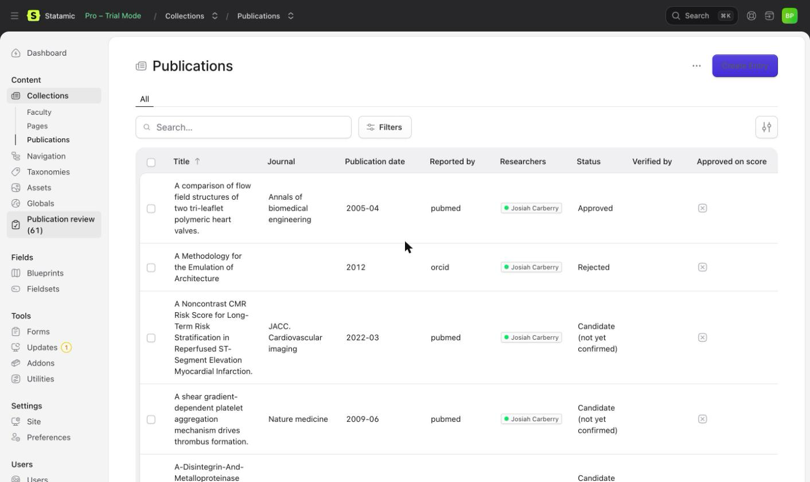
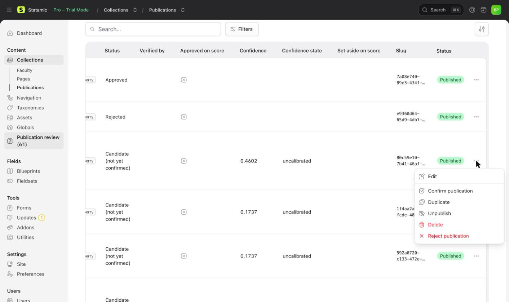
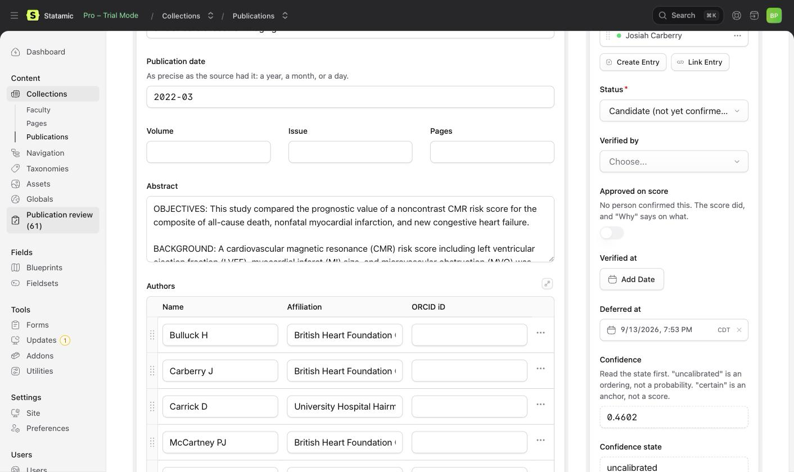
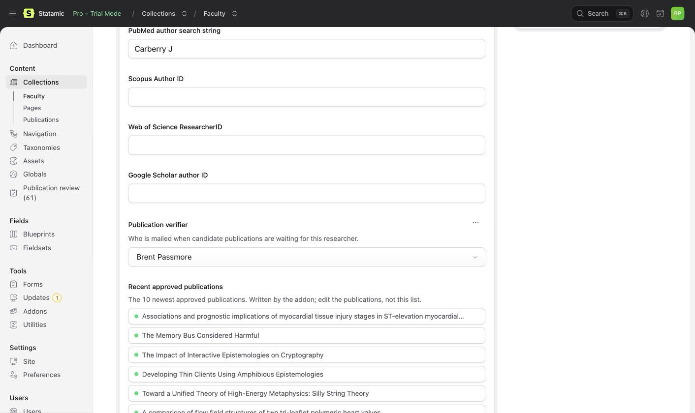
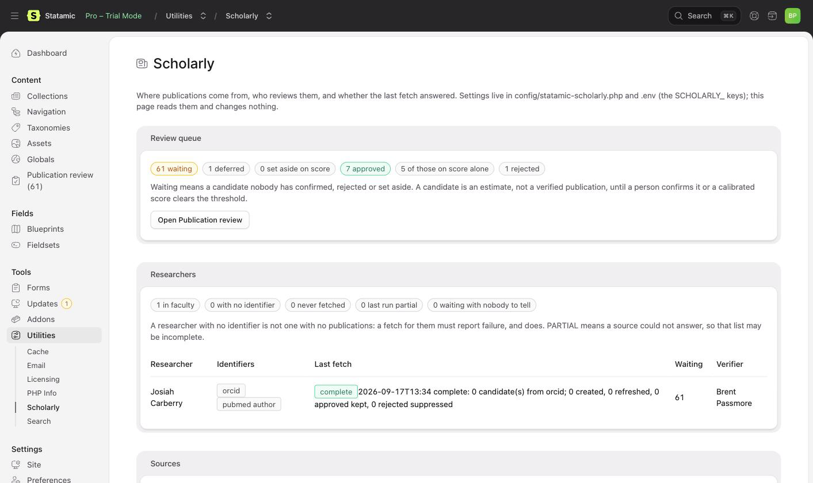

# Scholarly

Builds a verified publication list for a researcher profile in Statamic.

Publications are pulled from ORCID and PubMed, de-duplicated across sources,
scored, and queued for review. With automatic approval on, an ORCID claim or
a calibrated score can also approve a paper without a person. The hard part
is not fetching: it is knowing which of the many people sharing a name
actually wrote the paper.

> **Status: 0.x.** The data model may still change while the major version is
> 0. See the [changelog](CHANGELOG.md). Once it is 1, the publication entry
> shape will not change without a migration path, because sites will have
> verified entries by hand and cannot re-verify them.

## What it does

- Fetches from ORCID and PubMed, with author affiliations, author ORCID iDs
  and abstracts. Scopus and Web of Science are not yet built.
- De-duplicates on DOI, then PMID. A title match is flagged for a person
  rather than merged, because an erratum and the paper it corrects share a
  title and are different works.
- Scores every candidate with a breakdown that says why, and states plainly
  whether the number is certain, an uncalibrated ordering, or a calibrated
  probability. Calibrates from your verifiers' decisions when there are enough.
- Routes candidates through a review queue in the control panel. A paper
  reaches a public page when a person confirms it, when the researcher's own
  ORCID iD is on it, or when a calibrated score puts it at nine in ten or
  better. The last two say so on the entry, and a person can reverse them.
- Imports BibTeX and CSV, renders through an Antlers tag with citation
  styles, serves a JSON feed, and mails (or webhooks) verifiers a digest.

## What it looks like

| | |
|---|---|
|  |  |
|  |  |
|  | |

## What it will not do

- **It will not tell you a publication is definitely someone's work.** Outside
  an ORCID claim it is matching names, affiliations and co-authors, and a
  match is an estimate. A publication list on a profile is a claim about a
  named person, so a person, or a calibrated probability a person chose to
  trust, decides what goes on it.
- **It will not report an empty list as an answer when it could not look.** A
  source with a missing credential, a failed request or an unrecorded
  identifier is reported as a failure, because zero publications is otherwise
  indistinguishable from a researcher who has published nothing.
- It will not scrape Google Scholar. There is no API and scraping breaks its
  terms. BibTeX and CSV import is the supported route.
- It will not compute citation metrics.

## Requirements

- PHP 8.2 or newer, with `ext-dom` and `ext-libxml` (for PubMed's XML).
- Statamic 6.27 or newer. Entries on the flat-file Stache or on
  `statamic/eloquent-driver` (uuid or integer ids); the Eloquent driver
  itself needs PHP 8.3.
- A queue for the nightly fetch, or run it synchronously.

## Installing

The repository is private, so Composer needs to be told where it is and how
to authenticate. In the site's `composer.json`:

```json
"repositories": [
    { "type": "vcs", "url": "https://github.com/bpmore/statamic-scholarly" }
]
```

Then, with a GitHub token that can read the repository (Composer will ask
for one the first time, or set it with `composer config --global
github-oauth.github.com <token>`):

```
composer require bpmore/statamic-scholarly:^0.3
php artisan vendor:publish --tag=statamic-scholarly-config
php please scholarly:install
```

`scholarly:install` creates the publications collection the addon owns and
writes a `scholarly` fieldset for your researcher blueprint. It is safe to
run again.

### Give editors access

In **Users > Permissions**, grant **Scholarly > Verify publications** to people who
may confirm, reject or defer papers. Also grant the normal collection
permissions they need to open and edit publications and researcher profiles.
**Access Scholarly utility**, under Utilities, opens the read-only status
page. These are separate permissions; seeing the status page does not grant
the right to approve papers. Super users already have access.

### Run the schedule

The default schedule fetches publications and sends review notifications
daily. Enable Laravel's scheduler on the host, and run a queue worker when
the site's queue connection is not `sync`. To check one researcher without
a worker, use `php please scholarly:fetch <researcher> --sync`.

### Set a contact email

**The addon refuses to query NCBI without one.** NCBI asks every client to
identify itself so they can make contact before blocking a heavy one; an
addon on many sites that skipped this would make all of them anonymous
traffic, and the block would land on site owners who did nothing.

```
SCHOLARLY_NCBI_EMAIL=you@example.org
SCHOLARLY_NCBI_API_KEY=optional-but-raises-your-rate-limit
SCHOLARLY_ORCID_ACCESS_TOKEN=optional-too
```

### Say which fields hold identifiers

The addon does not assume your collection or field handles. In
`config/statamic-scholarly.php`, point it at whatever you use:

```php
'researchers' => [
    'collection' => 'people',
    'fields' => [
        'orcid'         => 'orcid_id',
        'pubmed_author' => 'pubmed_author_id',   // e.g. "Carberry J"
        // ...
    ],
],
```

A wrong handle fails quietly: the field reads empty, nothing is found, and
that looks exactly like a researcher with no publications. Check these first
when a fetch finds less than you expected.

### Import the fieldset and name a verifier

Import the `scholarly` fieldset into your researcher blueprint. Each
researcher's entry then shows their verifier, their ten newest approved
publications, how many candidates wait, and the last fetch's verdict. The
addon keeps those up to date; nothing is computed when the page renders.

Give a role the **Verify publications** permission, and set each
researcher's verifier in the new field. For researchers with none:

```
SCHOLARLY_VERIFIER_EMAIL=review@example.org
```

## Running a fetch

```
php please scholarly:fetch --sync     # every researcher, now, printing each report
php please scholarly:fetch            # every researcher, on the queue
php please scholarly:fetch jane-doe --source=pubmed --since=2024-01-01
php please scholarly:notify           # tell verifiers what is waiting
```

The schedule in config runs both daily. A report line says `complete` or
`PARTIAL`, and a partial run names the source that could not answer, because
zero publications from a source that never ran is not an answer.

## Reviewing

"Publication review" in the control panel opens the publications listing
and shows how many candidates are waiting. Filter to `Status: Candidate` and
use the Confirm, Reject and Defer actions on a row or a selection. To
correct a record first, edit the entry, then Confirm it.

Confirming records who did it and when. A rejected paper is never brought
back by a fetch, though a person can confirm it later.

## What the confidence number means

Each candidate shows a confidence score and, next to it, a state. Read the
state first.

- `certain`: the researcher's own ORCID iD is on the paper, or they claimed
  it on their ORCID record. The number is 1.0 and is not a score.
- `uncalibrated`: the shipped starting weights. The order is meaningful
  (co-authors you have published with, your affiliation, a rare name); the
  number is not a probability.
- `calibrated`: fitted to this site's decisions. A 0.90 was right about nine
  times in ten on decisions the fit did not see.

Open the entry to see why it scored as it did.

With `scoring.auto_approve` on (the default), a candidate is approved
without a person when its number means something and is at or above
`auto_approve_threshold` (0.90): an ORCID anchor, or a calibrated
probability. The shipped weights never approve anything. An
approved-on-score entry says so in the listing and a person can reject it.

Below `discard_floor` (0.30), a calibrated candidate is set aside: still in
the collection, still confirmable, but left out of the digest and filterable
out of the queue with "Set aside on score". Nothing is deleted, and a
candidate that later rises above the floor is asked about again.

Once your verifiers have made thirty or so decisions (at least ten each
way), run `php please scholarly:calibrate`. It fits the weights to those
decisions, prints how often a 0.90 was actually right, and, if the fit beats
the shipped weights, saves it. `--dry-run` reports without saving;
`--forget` goes back to the shipped weights.

## Importing a list

```
php please scholarly:import ~/carberry.bib josiah-carberry
php please scholarly:import ~/list.csv josiah-carberry --confirm-as=jc@example.edu
```

BibTeX from any reference manager (Google Scholar's export included), or a
CSV whose header names the columns (`title`, `doi`, `pmid`, `journal`,
`date`, `authors`, `abstract`, `volume`, `issue`, `pages`; Google Scholar's
own headers work too). Records are de-duplicated against what a fetch
already found and queue as candidates. `--confirm-as` approves them as that
person, which is the right thing when the file is the researcher's own list.

## Rendering

```antlers
{{ scholarly:publications researcher="{id}" sort="publication_date:desc" limit="5" }}
    <article>
        <h3>{{ title }}</h3>
        <p>{{ authors | scholarly_authors:3 }}, <em>{{ journal }}</em>, {{ publication_date format="Y" }}</p>
        <p>{{ id | scholarly_citation:apa:html }}</p>
    </article>
{{ /scholarly:publications }}
```

Only approved publications are ever returned, and there is no parameter to
change that. Approval does not override Statamic's publish state: draft,
scheduled and expired publications stay out of the list, count and feed.
The researcher must also be published. A private or missing researcher has
no public feed and produces an empty list and a zero count.
`researcher` takes an id or a slug and defaults to the current
entry; `year` takes `2020` or `2020:2024`; `sort`, `limit`, `paginate`, `as`
and `journal` work as on the collection tag.

- `{{ authors | scholarly_authors:3 }}` joins the first three author names
  and adds "et al." when there are more.
- `{{ id | scholarly_citation:ama }}` renders a citation (`ama`, `apa` or
  `vancouver`; add `:html` for an italic journal and escaped text). What the
  record lacks is left out, never filled in.
- `{{ scholarly:publications_count researcher="{id}" }}` gives the number.
- `{{ scholarly:feed_url researcher="{id}" }}` is a JSON feed of the same
  approved list, at `/!/statamic-scholarly/feed/{researcher}`, with
  `?year=`, `?journal=` and `?limit=`.

## Being told

`scholarly:notify` (scheduled with the fetch, or run by hand) mails each
verifier one digest of new candidates, says when the last fetch for a
researcher was partial, and never mentions the same candidate twice.
Deferred and set-aside candidates are left out. With no verifier and no
fallback address, the command says who could not be told and exits
non-zero. It never stays quiet about that.

To also POST each digest somewhere (a chat integration, a ticket queue), add
`webhook` to `notifications.channels` and set:

```
SCHOLARLY_WEBHOOK_URL=https://example.org/hooks/scholarly
SCHOLARLY_WEBHOOK_SECRET=a-long-random-string
```

The body is JSON; `X-Scholarly-Signature` is `sha256=` followed by the
HMAC-SHA256 of the exact body under the secret. Check it before trusting a
post.

## Seeing where things stand

Under Tools in the control panel, a page called Scholarly shows what the
addon knows about this site: candidates waiting, deferred and set aside;
every researcher with the identifiers they carry, what their last fetch
said and who is told when candidates wait on them; which sources will run
and why one will not; whether NCBI has its contact email; whether scoring
is calibrated; and how notifications and the schedule are set.

It reads. Nothing on it fetches, and nothing on it changes a setting: the
config file and `.env` are where that happens, and the page says so. A
researcher with no identifier is shown as that, not as one with no
publications; a partial run is shown as partial; a source that is off is
shown as off. The page keeps the same distinctions the run reports do.

Access is its own permission, **Access Scholarly utility**, under Utilities
in a role's permissions. Super users have it. Credentials are never shown,
only whether they are set.

## What it sends where

Every outbound request the addon makes, so you can decide whether that is
acceptable on your site. Nothing is sent on a page render; all of it runs
from `scholarly:fetch`, `scholarly:notify` and `scholarly:calibrate`.

- **NCBI E-utilities** (`eutils.ncbi.nlm.nih.gov`): the researcher's PubMed
  author string, PMIDs, your `SCHOLARLY_NCBI_EMAIL`, the tool name
  `statamic-scholarly`, and your API key if set. NCBI's usage policy asks
  for the email and tool name so they can contact a heavy client.
- **ORCID public API** (`pub.orcid.org`): the researcher's ORCID iD, and
  your access token if set.
- **Your webhook URL**, if configured: the review digest (researcher names,
  counts, the last run's verdict), signed.
- **Mail**, through your site's mail driver: the same digest to verifiers.

No candidate content, verifier decisions or site data go anywhere else.
Caches (NCBI responses for a week, the fitted model) live in your site's
cache store and `storage/app`.

## Upgrading

A published config does not gain new keys on its own. After an upgrade,
compare `config/statamic-scholarly.php` with the shipped one; a missing key
reads as the safe direction (for example, auto-approval off). Then run
`php please scholarly:install` again: it adds any fields the new version
ships to your existing blueprint and leaves everything you changed alone.
Your entries, decisions and configuration are never rewritten by an
upgrade.

After updating from 0.3.0, clear the site's static cache and purge any cached
publication pages or JSON feeds from your CDN. Older versions could include
an approved draft or a private researcher in public output; the fix cannot
remove responses already saved by a browser or an external cache.

## Adding your own source

Implement `Bpmore\Scholarly\Contracts\PublicationSource`, bind it, and tag
the binding `scholarly.sources`. A source returns a `FetchOutcome` rather
than an array, so it can report that it could not run rather than returning
nothing and being mistaken for an empty result.

If your application already has a PubMed client, bind
`Bpmore\Scholarly\Contracts\PublicationMetadataFetcher` to it. Otherwise you
get two clients caching the same records under different keys, and the two
caches can disagree.

## Support

Report a problem or ask a question at
<https://github.com/bpmore/statamic-scholarly/issues>. Say which version
(`composer show bpmore/statamic-scholarly`), which Statamic version, and,
for a fetch problem, the report line the command printed: it names the
source that could not answer.

## Licence

Free to use on any number of sites, with no key and no limit. Not free to
redistribute or to build another product from. See [LICENCE](LICENSE.md).
